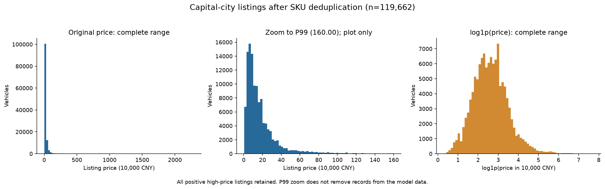
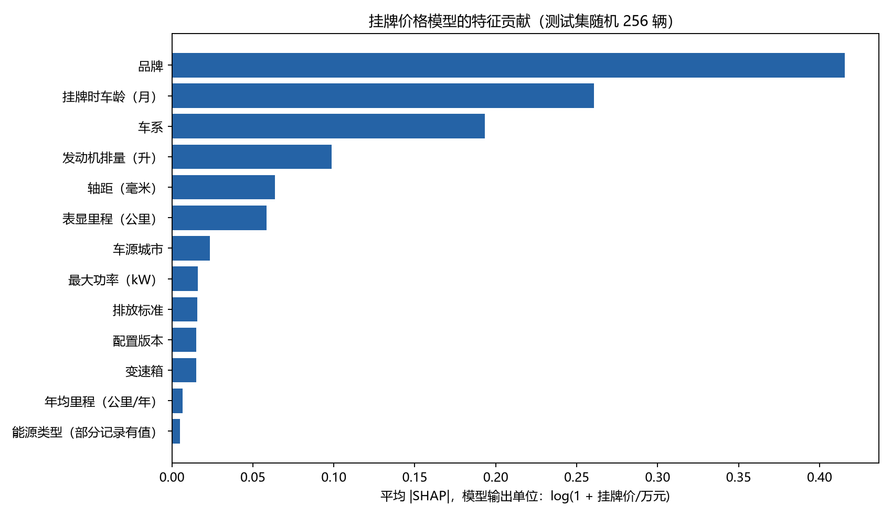

# UsedCarPriceXAI

基于集成学习的二手车疑似异常挂牌价格识别与可解释分析。本科毕业设计，研究主线为数据清洗、价格建模、异常初筛、SHAP解释与可视化。

当前为第一周基线，已跑通 **数据 → 模型 → 解释**。现有实验使用懂车帝车源快照；旧版天池数据文件已从当前目录移除，仍可通过Git历史恢复。

## 已完成

- 原始143,793条记录，按详情链接SKU去重，再筛选31个省会、自治区首府及直辖市，得到119,662条。
- 修复错位表头，解析嵌套档案与参数，统计缺失值，保留高价车并添加复核标志。
- 在训练集拟合类别编码和插补，对比Ridge、LightGBM原价目标与log1p目标。
- 独立校准集构建90% split-conformal价格区间，输出疑似高价/低价初筛结果。
- 输出全局和单车TreeSHAP解释，并验证SHAP加和关系。
- 整理18篇2024—2026正式卷期期刊文献（中文7篇、英文11篇），记录来源、阅读深度和引用用途。

## 实验快照

2026-10-23，固定随机种子2026。训练/验证/校准/测试比例60%/15%/10%/15%，SKU互斥；以下均为17,950条测试集结果。

| 模型 | MAE（万元） | RMSE（万元） | R² |
|---|---:|---:|---:|
| Ridge + One-Hot + log1p | 3.2100 | 13.3388 | 0.8767 |
| LightGBM原价目标 | 1.9106 | 6.1533 | 0.9738 |
| LightGBM对数目标 | 1.8795 | 8.2410 | 0.9529 |

按验证集MAE选择对数树模型用于解释。原价模型RMSE更低，不能说对数模型全面更优。90%区间测试覆盖率约90.02%，这不是异常识别准确率。





## 环境与运行

推荐Python 3.12，在仓库根目录运行。依赖锁定文件对应本次Windows实际运行环境。

```powershell
python -m venv .venv
.\.venv\Scripts\python.exe -m pip install -r week1\requirements-lock.txt
```

原始数据不随代码仓库分发。将已有的 `懂车帝全国各个省会城市二手车相关数据.csv` 放到仓库根目录后执行：

```powershell
.\.venv\Scripts\python.exe -X utf8 week1\src\preprocess.py --reference-year 2026
.\.venv\Scripts\python.exe -X utf8 week1\src\train_baseline.py
.\.venv\Scripts\python.exe -X utf8 week1\src\verify_outputs.py
```

也可指定数据位置：

```powershell
.\.venv\Scripts\python.exe -X utf8 week1\src\preprocess.py --source "D:\datasets\懂车帝全国各个省会城市二手车相关数据.csv" --reference-year 2026
```

macOS/Linux将Python命令改为 `.venv/bin/python`。跨平台环境需自行验证；仓库记录的完整运行结果来自Windows。生成文件会写到week1下的data、reports、models和figures目录。`verify_outputs.py`验证全量流程，不用于`--max-rows`采样训练模式。

## 目录与阅读入口

```text
week1/
  src/                 预处理、建模、校验和文献汇总脚本
  literature/          文献题录、阅读笔记、引用台账和BibTeX
  reports/             数据审计、缺失统计、模型指标与SHAP结果快照
  figures/             价格分布及解释图
  data/                数据说明与100行真实样例；全量数据本地生成
  models/              本地生成的模型，不进入Git
  requirements-lock.txt
```

- [第一周任务完成情况](week1/README.md)
- [数据准备与字段说明](week1/data/README.md)
- [预处理报告](week1/reports/preprocessing_report.md)
- [模型与解释报告](week1/reports/model_baseline_report.md)
- [文献引用台账](week1/literature/literature_review_ledger.md)
- [BibTeX](week1/literature/references.bib)

第二周原型已加入：

- [Streamlit可视化页面](week2/app.py)
- [异常初筛管线](week2/src/anomaly_detection.py)
- [异常筛查报告](week2/reports/anomaly_screening_report.md)
- [外部挂牌价格辅助核验记录](week2/reports/external_validation_protocol.md)

启动页面：

```powershell
.\.venv\Scripts\python.exe -m pip install -r week2\requirements-dashboard.txt
.\.venv\Scripts\python.exe -m streamlit run week2\app.py
```

## 研究边界

- 目标为挂牌价，不是真实成交价或车辆价值；区间越界仅提示人工复核。
- 数据的间接时间线索集中于2024年4—5月，尚缺原始发布页/采集日志，不能正式声称已证明近五年采集时间。
- 当前车龄（2026减注册年）仅用于展示；历史价格模型使用原始挂牌时车龄。功率单位是kW，能源类型缺失不代表燃油。
- 没有真实异常标签，尚未报告异常识别Precision、Recall、F1。人工核验应独立于模型判定，并使用同期可比车源。
- 已按SKU去重，但缺少VIN，不能排除不同SKU重复发布同车。当前随机留出评估不代表跨时间或跨平台泛化。
- 文献多为摘要级阅读；4篇2023年在线首发、2024年正式见刊，已逐条说明。6篇《软件学报》有核心收录介绍证据，学校具体目录版本和外文分区仍需核验。

## 许可证

保留仓库原有 [Apache-2.0许可证](LICENSE)。第三方数据和论文按各自权利及使用条件处理；本仓库不以代码许可证授予原始数据或论文全文的再分发权。
